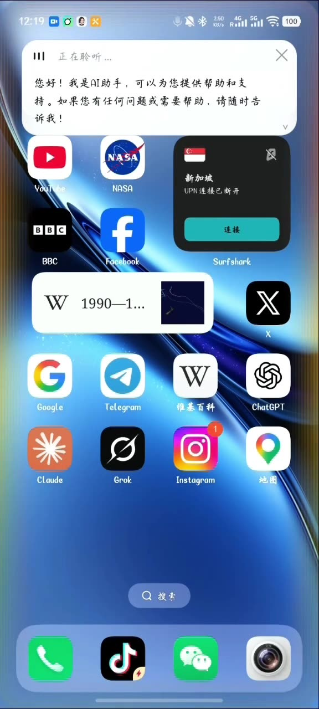
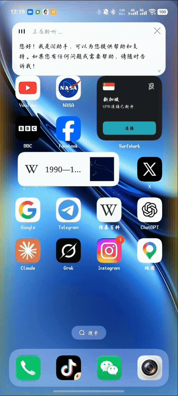

# dshgo-assist — 把 vivo「蓝心小V」替换成 DSH 语音助手

一个跑在 **DSH Go** 手机上（Android + proot Ubuntu）的语音助手外挂：
按住/双击电源键唤起悬浮胶囊 → 本地离线识别 → 本地小模型先答 → 答不了转交 DSH → 白卡片显示（可流式打字）。

> 面向 **vivo / OriginOS** 机型（实测 vivo X200 / Android 16），替换系统级语音助手入口，
> 不切换前台应用、不打断你正在用的 App。

## 演示视频

[](media/demo.mp4)

▶️ **点封面看完整视频**（15 秒 · GitHub 内置播放器）· 下面是 7 秒动图预览：



演示内容：双击电源键唤起悬浮胶囊 → 说话（实时字幕）→ 本地 0.6B 逐字作答 → 转交 DSH 时卡片继续更新。

## 特性

- **悬浮胶囊 + 全屏边缘流光**：应用级悬浮窗（`TYPE_APPLICATION_OVERLAY`），Siri/Apple Intelligence 风格
- **本地离线识别**：sherpa-onnx + SenseVoice，`127.0.0.1:18080`，一句话约 100~150ms
- **本地小模型先答**：Qwen3-0.6B（llama.cpp / node-llama-cpp），热态 0.5~2s，**支持流式打字机**
- **自动分流**：命中「打开应用/发消息/天气/几点…」等规则或需要实时信息 → 转 DSH
- **连续对话**：答完自动续听，同一张卡片内进行；一旦转过 DSH，本会话后续都走 DSH
- **双击电源键唤起**：root 钩子（`/data/local/tmp/dsh-powerhook.sh`）+ 看门狗 + 开机自启
- **一键接管 / 可回滚**：App 内按钮写入设置与钩子；提供还原脚本

## 目录结构

```
apk/          最终 APK（dsh-assist-v56.apk）
app/          Android App 源码（Java，无 Gradle：手写 AXML 打包）+ 校验脚本 + 构建脚本
plugin/       DSH 本地插件（engine-bridge）：托管识别服务、本地模型、inbox→DSH→outbox 桥
local-model/  本地模型路由服务（router-server.mjs，端口 18085）
docs/         可行性报告（系统级窗口、引擎桥接等）与踩坑记录
```

## 快速开始

### 1) 装 APK
```bash
adb install -r apk/dsh-assist-v56.apk
# 或在手机上直接点开安装（同签名可覆盖升级）
```

### 2) 打开「DSH 小V」→ 允许悬浮窗 + 麦克风 → 点「一键接管」
接管会写入：电源键设置、助手角色、电源键钩子（root 所有）、看门狗、开机自启脚本。

### 3) 插件（DSH 侧）
```bash
dsh plugin --profile web add /path/to/plugin     # 装完重启引擎
```
插件会在引擎启动时托管：识别服务（18080）、本地模型路由（18085）、inbox/outbox 文件桥。

### 4) 本地模型（可选，但推荐）
```bash
# 下载 Qwen3-0.6B GGUF（Q8_0，约 610MB）放到手机 /sdcard/Download/
cd local-model && npm i node-llama-cpp   # 用 npmmirror 等镜像
PORT=18085 node router-server.mjs
```

## 架构

```
电源键(双击) ──> OverlayService(悬浮胶囊/流光/卡片)
                       │
          AudioRecord + VAD(文字静默判定)
                       │  POST /transcribe
                 识别服务 :18080
                       │
        ┌──────────────┴──────────────┐
   规则命中(打开/发消息/实时信息)     否则
        │                             │
        │                    POST /ask-stream :18085
        │                    本地 Qwen3-0.6B（KV 前缀缓存 + 流式）
        │                             │
        │                     答不了 → ESCALATE
        └──────────────┬──────────────┘
                       ▼
              dsh-inbox/<ts>.txt
                       │  （DSH 插件：引擎内 agent 跑一轮，1~3s）
              dsh-outbox/<ts>.txt
                       ▼
                 卡片显示答案
```

## 已知限制

- **电源键钩子需要 root**：接管后 `short_press=0`（短按交给钩子做「延后熄屏」）。
  **重启后若 root 未恢复，电源键会暂时无响应**，重新提权后点一次「一键接管」即可恢复。
- 悬浮窗属**应用级**（type 2038），永远在状态栏/手势条之下；Android 16 上 root 进程也无法加系统级窗口
  （WMS 要求进程已在 AMS 登记）。详见 `docs/syswin-feasibility.md`。
- 本地 0.6B 只适合闲聊/算术/改写；**事实性与实时性一律转 DSH**（模型太小，会编）。
- 无法拦截 vivo 原生唤醒词（`com.vivo.voicewakeup` 走的是对 vivo 自家包的显式调用）。

## 构建（App）

```bash
cd app && bash build-assist-apk.sh     # 需要 JDK 17；产出 out/dsh-assist-<ver>.apk
python3 verify.py                       # 334 项静态校验
```

## 免责声明

本项目通过替换系统助手入口、修改系统设置与（可选）root 钩子实现，**仅供个人设备折腾使用**。
请自行评估风险（改设置/权限/root 钩子都可能导致设备行为异常），作者不承担任何后果。
